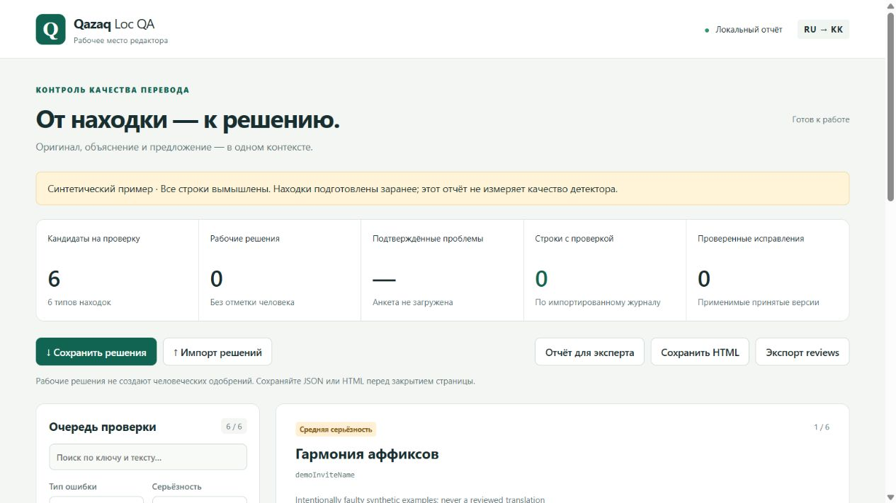
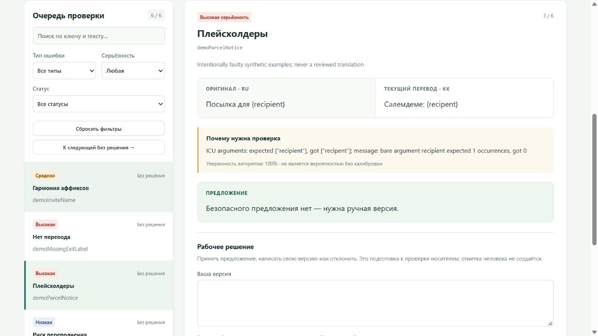
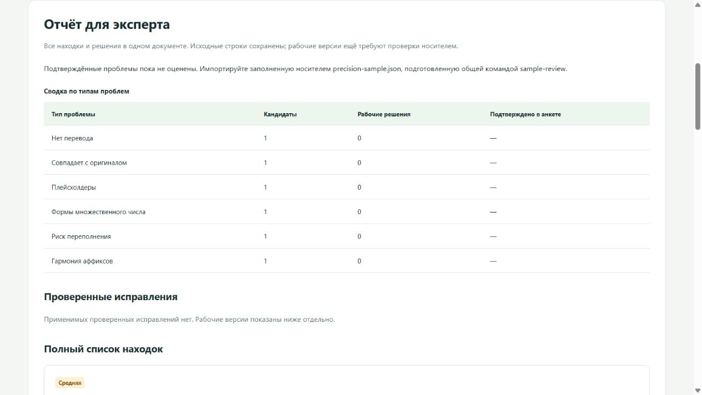
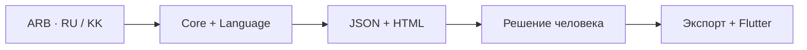

# Qazaq Loc QA

**От ARB-файла — к понятной находке и проверенному исправлению.**

Инструмент команды для контроля казахской локализации игры по русскому оригиналу.
Он проверяет структуру и язык, показывает причину каждой находки и помогает редактору
подготовить правку. Экспорт связывает изменение с точным решением человека и проверкой Flutter.

**RU → KK · 11 типов находок · 5 частей команды · локальный анализ**

[Быстрый старт](#быстрый-старт) · [Интерфейс](#как-выглядит-работа) · [Проверки](#что-проверено) · [Команда](#вся-команда-в-одной-сборке) · [Ограничения](#статус-и-границы-результата)



*Настоящий интерфейс на вымышленных строках. На выбранном примере — 6 находок;
это демонстрация работы, а не измерение точности на скрытом наборе.*

> **Для жюри:** вся командная работа находится в [ветке codex/team-integration](https://github.com/foxfordkz-cyber/stupits-karaganda/tree/codex/team-integration).
> Код, демонстрация и воспроизводимые проверки готовы к передаче.
> Реальный выпуск исправленных переводов остаётся `HUMAN_REVIEW_PENDING`.

## Быстрый старт

Нужны **Node.js 22+**, **Python 3.10+** и **Flutter SDK** в `PATH`.
Дополнительные Python-пакеты не требуются.

```sh
git clone --branch codex/team-integration https://github.com/foxfordkz-cyber/stupits-karaganda.git qazaq-loc-qa
cd qazaq-loc-qa
npm ci
npm run verify-team
```

Если у вас ZIP, распакуйте его, откройте папку `qazaq-loc-qa` и выполните последние
две команды. Установка зависимостей требует сети; стандартный языковой анализ
выполняется локально, без обращений к модельному API.

Команда проверит тесты, контракты, все модули, экспорт через Flutter и упаковку.
Она создаст новый каталог вне Git и выведет его путь. Внутри:

- `team-pipeline/run/report.html` — результат настоящих детекторов на синтетике;
- `verification.json` — итог проверки, рядом отдельные логи;
- `core-flutter/` — доказательства положительных и отрицательных сценариев экспорта;
- `packaging/` — проверка состава и целостности пакета.

**Показать проект за три шага:** откройте `report.html`, выберите карточку
плейсхолдеров, затем переключитесь в «Отчёт для эксперта».
В архиве для жюри также есть готовый `demo-synthetic/report.html`.

<details>
<summary>Windows, свой каталог результатов и настройка Python</summary>

На подготовленном компьютере из любой папки:

```bat
C:\stupits-karaganda-integration\verify.cmd
```

Для своего нового каталога:

```sh
node scripts/verify-team.mjs --out ../locqa-private/verification-001
```

Если Python недоступен через `python` / `python3`, задайте `LOCQA_PYTHON` полным
путём к программе. Проверены Node 24.17.0, Python 3.14.3, Flutter 3.41.2 / Dart 3.11.0.
`npm run demo` — отдельное воспроизведение подготовленных находок, а не запуск детектора.

</details>

## Как выглядит работа

### 1. Найти причину, а не только подсветку

Карточка ставит рядом оригинал, текущий перевод, объяснение и предложение.
В примере `{recipient}` превратился в `{recipent}`: ядро показывает конкретное
несовпадение. Когда безопасной замены нет, система оставляет решение редактору.



Поиск и фильтры помогают выбрать тип, серьёзность и состояние строки.
Рабочую версию можно сохранить в JSON или самостоятельном HTML и открыть позже.
Черновик не превращается в человеческое одобрение; существующий журнал решений
импортируется отдельно и проверяется на соответствие версиям.

### 2. Передать эксперту полный контекст

Экспертный режим собирает все находки в одном документе, независимо от фильтров
рабочей очереди. Он разделяет кандидатов, рабочие решения, подтверждённые проблемы
и проверенные исправления. Если человеческих оценок нет, сводка показывает это явно.



Все три скриншота сняты с одного сохранённого синтетического прогона реальных
Core/Language и HTML-модуля Тони. В общем контракте 11 категорий; этот небольшой
набор дал 6. [Происхождение снимков](docs/images/README.md).

## От анализа до экспорта



**Чтение.** Core сохраняет вхождения ключей, разделы, метаданные и хэши точных текстов.
Дубли и структурные ошибки попадают в отдельную диагностику.

**Анализ.** Технические и языковые правила выдают объяснимые находки.
Объединение сохраняет варианты наблюдений и не выбирает конфликтующую правку автоматически.

**Решение.** Для выпуска нужны точный проверенный текст, автор, дата и хэши версий.
Изменение source, original target или approved text делает старое одобрение неприменимым.

**Экспорт.** Core применяет актуальные решения, проверяет технические элементы
текста, затем запускаются независимая проверка, `flutter gen-l10n` и упаковка.
Тестовые одобрения проверяют этот маршрут только на придуманных строках.

## Какие проблемы ищет система

| Проверка | Что замечает |
|---|---|
| `untranslated` | Отсутствующий или пустой перевод |
| `same_as_source` | Совпадение с оригиналом с учётом исключений |
| `placeholder_mismatch` | Потерянные, изменённые или лишние аргументы |
| `plural_mismatch` | Проблемы структуры ICU и ветвей множественного числа |
| `length_overflow` | Риск переполнения по длине видимого текста |
| `glossary_violation` | Нарушение правил согласованного расширенного глоссария |
| `machine_translation_suspect` | Ограниченные сигналы неестественной формулировки |
| `inconsistent_term` | Несогласованное употребление понятия в доступном контексте |
| `suffix_harmony` | Риск фиксированного аффикса после динамического значения |
| `orthography` | Известные орфографические проблемы и отдельные смешения символов |
| `wrong_language` | Лексические признаки другого языка в строке или фрагменте |

Вложенный ICU разбирается структурно. Формы множественного числа RU и KK не обязаны
совпадать. При исправлении проверяются плейсхолдеры, форматные токены, теги,
переносы и специальные символы.

Языковые правила имеют ограниченную область действия и предлагают кандидатов для
проверки. Для строгих терминологических нарушений нужен расширенный согласованный
JSON-глоссарий; командный CSV импортируется как черновик. Подозрение на машинный
перевод не доказывает его происхождение. [Подробнее о правилах](modules/language/README.md).

## Проверить свои ARB

Из корня проекта, подставив пути к закрытым исходникам:

```sh
node scripts/run-pipeline.mjs --config contracts/examples/pipeline.json --source /private/intl_ru.arb --target /private/intl_kk.arb --glossary modules/linguistics/glossary.csv --combine-same-text --out ../locqa-private/analysis-001
```

Выход должен быть новым и находиться **вне любого Git checkout**. Исходники не
меняются. Без `--reviews` выполняется анализ; исправленный ARB не создаётся.

Опция `--combine-same-text` объединяет наблюдения одного типа только на точной
паре source/target. Объяснения и предложения остаются в `merge-audit.json`.
При разных предложениях итоговый `suggestion` пуст. Разные версии текста и
неоднозначные дубли этим не разрешаются. Без опции действует строгий отказ при конфликте.

<details>
<summary>Отдельная команда Core и экспорт по человеческому журналу</summary>

Пять технических проверок:

```sh
node modules/core/cli.mjs check --source /private/intl_ru.arb --target /private/intl_kk.arb --glossary modules/linguistics/glossary.csv --out ../locqa-private/core-001
```

На Windows тот же интерфейс доступен через `modules\core\locqa.cmd check`.
Полный анализ с языковым модулем запускается через `scripts/run-pipeline.mjs` выше.

После проверки человеком и согласования исходной структуры:

```sh
node modules/core/cli.mjs export --source /private/intl_ru.arb --target /private/intl_kk.arb --reviews /private/reviews.json --out ../locqa-private/approved-001 --verify-flutter
```

Конфликтующие target-дубли требуют `--resolutions`. Машинный кандидат не должен
подменять исходный baseline ради прохождения проверки. Финальный пакет формируется
через [проверяемую упаковку](docs/PACKAGING.md).

</details>

## Что получает проверяющий

| Результат | Назначение |
|---|---|
| `bundle.json` | Тексты, контекст, конкретные вхождения и хэши версий |
| `core-report.json`, `language-report.json` | Результаты каждого диагностического модуля |
| `report.json`, `report.html` | Общие находки и автономный интерфейс |
| `*.diagnostics.json`, `merge-audit.json` | Структурные проблемы и сохранённые варианты наблюдений |
| `language-report.json.details/` | Очередь v2, предложения, привязки находок и метрики |
| `pipeline-evidence.json` | Этапы, коды завершения, хэши входов/выходов, состояние экспорта |
| `glossary.csv` | 40 черновых терминов: `ru,kk,en,comment` |
| `reviews` | Точные решения реального проверяющего; без проверки журнал пуст |
| `intl_kk_fixed.arb` | Результат защищённого экспорта при выполненных условиях |

Находка содержит девять полей: `key`, `issue_type`, `severity`, `source`, `target`,
`evidence`, `suggestion`, `confidence`, `reviewed_by_human`. Привязки к вхождениям
хранятся отдельно. Очередь Language v2 относится к отдельному языковому отчёту;
HTML использует общие bundle/report. [Общие контракты](docs/CONTRACTS.md).

## Что проверено

| Проверка | Подтверждённый результат |
|---|---|
| Локальные тесты | **285 пройдено · 0 ошибок · 2 пропуска** на Windows |
| Python-регрессии | Входят в `npm test`, отдельные зависимости не нужны |
| Контракты и примеры | `npm run check` пройден |
| Все модули вместе | Core → Language → объединение → HTML → аудит решений |
| Экспорт и Flutter | Положительные сценарии и отказ при небезопасном выпуске |
| Архив кода | Проверен после распаковки; контрольные суммы файлов сверены |
| GitHub Actions | Windows/Linux с Node 22/24 и отдельный Flutter: **5 успешных заданий** |

[Открыть подтверждённый запуск CI](https://github.com/foxfordkz-cyber/stupits-karaganda/actions/runs/41221718753).
Локальные пропуски относятся к созданию символических ссылок; на CI условия могут
отличаться. Эти проверки подтверждают работоспособность и ограничения инструментов,
но не измеряют языковое качество или полноту обнаружения на скрытом наборе.

## Вся команда в одной сборке

| Участник | Вклад | Модуль |
|---|---|---|
| **Дамир** | Чтение ARB, структурный ICU, CLI, технические проверки и безопасный экспорт | [Core](modules/core/README.md) |
| **Бекзат** | Языковые правила, контекст, кэш, бюджеты, очередь v2 и контроль передачи решений | [Language](modules/language/README.md) |
| **Айдана** | Глоссарий, редакторская политика, пакеты по 20–30 строк и аудит решений | [Linguistics](modules/linguistics/README.md) |
| **Тони** | HTML, поиск, фильтры, рабочие правки, восстановление сессии и экспертный режим | [Report](modules/report/README.md) |
| **Интегратор** | Контракты, общий маршрут, методология, контроль хэшей, Flutter и упаковка | [Pipeline](docs/PIPELINE.md) |

<details>
<summary>Все 8 включённых веток и версии</summary>

| Ветка | Включённая версия |
|---|---|
| `codex/integration-kit` | `62fa3a8` |
| `codex/core-cli` | `5171fcf` |
| `aidana/linguistics-glossary-review` | `d644e43` |
| `bekzat/stability-hardening` | `4d7e001` |
| `bekzat/language-quality-benchmark` | `56e0e36` |
| `bekzat/contextual-language-quality` | `c573d93` |
| `bekzat/human-review-quality-gate` | `b1bb106` |
| `tony/report-review-ui` | `957e8b0` |

Все ветки включены в `codex/team-integration`. Ранние версии Бекзата входят в
историю последней. Слияние сохранило исходные ветки и коммиты. Старые числа в README
отдельных модулей относятся к их передаче, а не к итоговому прогону всей команды.

</details>

## Статус и границы результата

**Готово к демонстрации:** общий код, воспроизводимый запуск, анализ ARB,
JSON/HTML-отчёт, процесс проверки решений, защищённый экспорт и технические тесты.

**Требует завершения на реальных материалах:** проверка точных переводов носителем,
согласование глоссария, решения по конфликтующим дублям и совместимость изменений
ключей с игровым клиентом. Его исходники не предоставлены. Успешный `gen-l10n`
не подтверждает смысл перевода, игровой контекст, реальные размеры или шрифты UI.

ИИ не создаёт `reviewed_by_human=true` для реальных строк. Кнопки редактора сохраняют
черновики; официальный журнал содержит только отдельно импортированные применимые
человеческие решения. Precision/recall скрытого набора неизвестны.

**Исходные выгрузки, реальные отчёты и журналы остаются вне публичного репозитория.**
Архив кода и скриншоты содержат только придуманные примеры. Закрытый рабочий пакет
передаётся отдельно и не выдаётся за финальную одобренную локализацию.

## Документация

[Контракты](docs/CONTRACTS.md) · [Методология](docs/METHODOLOGY.md) ·
[Человеческая оценка](docs/HUMAN_EVALUATION.md) · [Контроль передачи решений](modules/language/REVIEW_GATE.md) ·
[Дубли](docs/DUPLICATES.md) · [Состав сдачи](docs/SUBMISSION.md) · [Упаковка](docs/PACKAGING.md)
